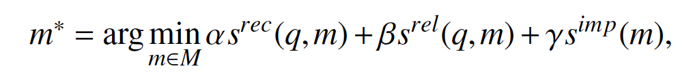
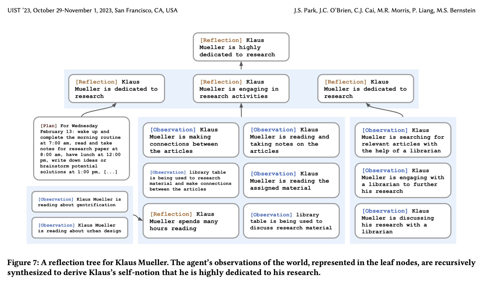
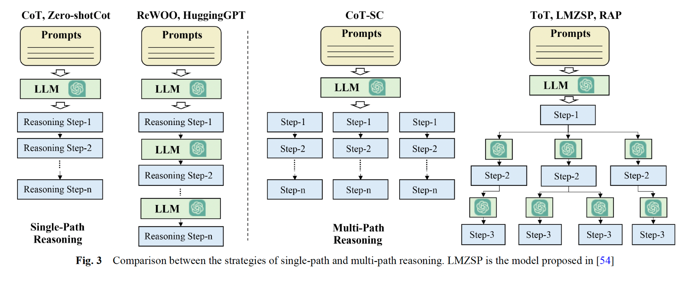

# Architecture : Mémoire, Planification & Action

Cette section s'appuie notamment sur l'article de synthèse académique [*A Survey on Large Language Model based Autonomous Agents* (Wang et al., 2024)](https://link.springer.com/article/10.1007/s11704-024-40231-1) pour décortiquer l'architecture interne d'un agent autonome en trois modules : **la mémoire**, **la planification (*planning*)** et **le module d'action**.

---

## A. Mémoire de l’agent

Nous avons pu voir dans les projets précédents (*RAG* et *Call Me Maybe*, que j’abrègerai en **CMM**) comment prompter un LLM avec un prompt système et un prompt utilisateur « client ». Mais nous ne le faisions que de manière **statique** (*one-shot*), c’est-à-dire une seule fois afin que le LLM réponde à une unique consigne.

**Agent Smith** demande une **implémentation cyclique de la mémoire** pour que, lors des différents essais de l’agent pour générer et corriger du code, il se « souvienne » de ce qui a déjà été tenté et des opérations effectuées pour mener à bien sa tâche : un véritable **fil rouge** d'itération en itération.

### Le compromis de la fenêtre de contexte

Ce fenêtrage mémoriel est une grandeur quantifiable et mesurable, mais à double tranchant :

> « En pratique, la mise en place d'une mémoire à court terme est simple et peut renforcer la capacité d'un agent à percevoir des comportements ou des observations récents ou sensibles au contexte. Cependant, en raison de la limitation de la fenêtre contextuelle des LLMs, il est difficile d'inclure l'ensemble des mémoires dans le prompt, ce qui peut dégrader les performances des agents. Cette approche impose donc des exigences élevées en termes de longueur de fenêtre pour les LLM et de capacité à gérer de longs contextes. »
>
> — *Source : [Wang et al., 2024, p. 4](https://link.springer.com/article/10.1007/s11704-024-40231-1)*

Une technique alternative est la **mémoire hybride (*hybrid memory*)**, calquée sur le fonctionnement de la mémoire humaine, qui combine :
* une **mémoire à court terme (*short-term memory*)** ;
* une **mémoire à long terme (*long-term memory*)**.

La littérature ne dicte pas une manière unique de l'implémenter :
* Certains agents utilisent comme *short-term memory* la situation actuelle de l’agent et son contexte immédiat, puis archivent dans la *long-term memory* les réflexions et les actions passées.
* D’autres conservent l'historique récent du prompt comme *short-term memory* et utilisent de l’*embedding* vectoriel dans une base de données externe pour stocker la *long-term memory* et faciliter le *retrieval*.

Il existe ainsi plusieurs formats pour stocker la mémoire : langage naturel brut, *embeddings* vectoriels, bases de données relationnelles/NoSQL, listes structurées de messages (`self.messages`), etc.

---

### Les 3 opérations fondamentales sur la mémoire

Quand l’agent est lancé, sa gestion mémorielle repose sur trois opérations :

#### 1. Lire la mémoire (*Memory Reading*)
L'objectif est de comprendre le contexte et de tirer des informations pertinentes qui vont améliorer le comportement de l'agent aux étapes suivantes. La difficulté principale est d'extraire les informations qui ont le plus de valeur au sein de tout l’historique.

Trois critères définissent une bonne lecture de mémoire : **la récence (*recency*)**, **la pertinence (*relevance*)** et **l'importance (*importance*)**. On les modélise généralement par la formule de scoring suivante :

$$m^* = \arg\max_{m \in M} \Big( \alpha \, s^{\text{rec}}(q,m) + \beta \, s^{\text{rel}}(q,m) + \gamma \, s^{\text{imp}}(m) \Big)$$


**Note sur la formule :**
* $q$ est la requête actuelle (*query*), et $M$ est l’ensemble de toutes les mémoires stockées.
* $s^{\text{rec}}$, $s^{\text{rel}}$ et $s^{\text{imp}}$ sont les fonctions de scoring mesurant respectivement la **récence**, la **pertinence** et l’**importance** d'un souvenir $m$.
* Ces fonctions de scoring peuvent être obtenues en calculant la similarité cosinus entre vecteurs d'embeddings (pour $s^{\text{rel}}$), une décroissance temporelle (pour $s^{\text{rec}}$) ou un score attribué par le LLM (pour $s^{\text{imp}}$). Plus leur score est élevé, plus la mémoire $m$ a de valeur (d'où la maximisation sur $m \in M$, malgré la coquille typographique $\arg\min$ présente dans certaines versions du papier source).
* $\alpha$, $\beta$ et $\gamma$ sont des **paramètres d’équilibrage** : si l'on fixe par exemple $\alpha = 0$ et $\gamma = 0$, on ne sélectionne les souvenirs que selon $\beta$, c'est-à-dire la pure pertinence sémantique.


#### 2. Écrire la mémoire (*Memory Writing*)
Il s'agit de stocker l’information issue de l’environnement perçu. Cette étape est essentielle pour constituer une base de connaissances permettant à l’agent d’être efficace et rationnel sur la durée (éviter de répéter 10 fois la même commande qui échoue !).

Écrire dans la mémoire soulève deux défis :
1. **Éviter la redondance** : ne pas réécrire deux informations quasi identiques dans la mémoire.
2. **Gérer la saturation (oubli / compaction)** : savoir comment élaguer ou compresser l'information quand la mémoire atteint sa limite de stockage (par exemple la limite des `6 000` tokens d'input sur MBPP ou `300 000` sur SWE-bench).

*Technique classique :* stocker les descriptions des actions relatives à un sous-objectif dans une liste, et dès que la taille de cette liste dépasse un seuil donné, condenser ces entrées en un résumé unique à l'aide du LLM.

#### 3. Réfléchir sur la mémoire (*Memory Reflection*)
C'est le mécanisme qui permet à l'agent d’évaluer ses propres processus cognitifs et comportementaux : **résumer ses expériences passées de manière autonome pour en tirer une vision plus abstraite**.

*Exemple de technique (issue de l'article [Generative Agents, Park et al., 2023](https://arxiv.org/pdf/2304.03442)) :* l’agent génère trois questions clés basées sur sa mémoire récente, puis utilise ces questions pour interroger sa mémoire et en extraire des motifs pertinents. Le modèle génère alors des réflexions (*insights*) résumant les blocs d'observations passés, puis synthétise ces résumés en niveaux d'abstraction supérieurs (on peut même utiliser des sous-agents pour cela, ce qui relève du *harnessing*).

Voici l'illustration célèbre d'un arbre de réflexion où l'agent (*Klaus Mueller*) synthétise ses observations quotidiennes (feuilles en bas) en réflexions de plus en plus abstraites (racine en haut) :

> **À retenir :** La grande différence entre un LLM classique et un agent, c’est que l’agent doit acquérir la capacité d’apprendre de ses observations et d’effectuer des tâches dans un **environnement dynamique**.

---

## B. Planification (*Planning*)

Quand nous sommes confrontés à des tâches complexes, nous les décomposons naturellement en sous-problèmes plus petits avant de les résoudre un par un. Les agents modernes fonctionnent de manière analogue.

On distingue d'abord deux grandes familles de planification sans retour direct de l'environnement :
1. **Le *Single-Path Reasoning*** : le LLM ne génère qu’un seul chemin de résolution linéaire.
2. **Le *Multi-Path Reasoning*** : le LLM explore simultanément plusieurs pistes sous forme d'arbre.

### 1. Planification sans feedback : Single-Path vs Multi-Path



Dans cette approche linéaire, le plan suit une seule trajectoire :

* **Chain of Thought (CoT)** : le LLM propose plusieurs étapes progressives à la suite qui lui servent de fil conducteur pour raisonner étape par étape. Le LLM n’a pas de feedback en direct de l'environnement pendant qu'il déroule sa pensée, mais on lui fournit dans le prompt un exemple structurel (*few-shot*) du raisonnement attendu.
* **Zero-shot CoT** : sensiblement la même chose, mais sans exemple fourni dans le prompt ; on demande simplement au modèle de raisonner *« step-by-step »*.
  * *Note : on peut se servir du re-prompting pour vérifier la cohérence de chaque étape une par une et faire régénérer le plan au LLM s’il y a une erreur.*
* **ReWOO (*Reasoning Without Observation*)** : sépare la planification des observations externes. Il génère d'abord l'intégralité du plan symbolique, obtient ensuite les observations indépendamment, puis combine `plan + observations` pour produire le résultat final.
* **HuggingGPT** : décompose d'abord la tâche en plusieurs sous-objectifs, puis résout chaque sous-objectif en faisant appel à des modèles ou outils spécialisés disponibles sur Hugging Face.

**Différence clé :** *CoT* et *Zero-shot CoT* génèrent leur raisonnement en **un seul appel (*one-shot*)** au LLM, tandis que *ReWOO* et *HuggingGPT* effectuent une **résolution multi-appels** où le système sollicite le(s) LLM(s) plusieurs fois au cours du processus.



Dans cette stratégie, les étapes sont organisées comme une **structure en arbre** où chaque étape intermédiaire peut bifurquer en plusieurs sous-étapes :

* **CoT-SC (*Self-Consistency*)** : part du principe qu’il existe plusieurs manières d’aborder un problème complexe. Le système génère plusieurs chaînes *CoT* simultanément et sélectionne la réponse finale par vote majoritaire ou selon la trajectoire la plus viable.
* **ToT (*Tree of Thoughts*)** : chaque nœud de l’arbre représente une « pensée » correspondant à une étape intermédiaire du plan de raisonnement. La sélection des branches prometteuses est basée sur une auto-évaluation par le(s) LLM(s), et le plan est exploré via un parcours d'arbre classique (**DFS** ou **BFS** — *lol*).

**Différence clé :** alors que *CoT-SC* génère chaque chaîne d'étapes d'un seul trait (`[étape1, étape2, étape3...]`), *ToT* effectue une requête au LLM **entre chaque étape** (`[étape1 → LLM → étape2 → LLM → étape3...]`) pour évaluer et élaguer les branches.



---

### 2. Planification avec Feedback (la clé d'Agent Smith)

Sur des tâches complexes de génie logiciel, les approches sans feedback ci-dessus s'avèrent vite limitées : prévoir l'intégralité d’un plan parfait dès la première seconde sans jamais regarder le code ou lancer un test est quasi impossible. Des étapes intermédiaires peuvent échouer en milieu de parcours et faire s'effondrer tout le plan.

L’idée est donc de fournir aux agents un **feedback continu** pour les aiguiller après chaque action et leur permettre de **s’auto-corriger** :

* **Le feedback environnemental (ReAct)** : il provient du monde réel ou d'un environnement d'exécution (la Sandbox, un conteneur Docker, une suite de tests) après une action de l'agent. Par exemple, le paradigme [**ReAct** (*Yao et al., 2022*)](https://arxiv.org/pdf/2210.03629) structure le raisonnement autour du triptyque **`Thought → Act → Observation`** :
  * **`Thought`** : raisonnement et planification pour déterminer la prochaine action.
  * **`Act`** : action effectuée par l'agent (dans *Agent Smith*, du **code Python exécutable**).
  * **`Observation`** : résultat concret retourné par l'environnement ou les outils externes (`stdout`, `stderr`, résultats de tests).
  * L'*Observation* alimente le *Thought* suivant, permettant à l'agent d'adapter dynamiquement son plan à la réalité du terrain. **C'est exactement l'architecture imposée par le sujet Agent Smith (`Thought → Code → Observation`).**
* **Le feedback humain** : interagir avec un opérateur humain pour clarifier une ambiguïté ou valider une action critique et incorporer ce retour dans le prompt suivant.
* **Le feedback du modèle (interne)** : généré par le modèle lui-même pour critiquer et affiner sa propre sortie avant de la valider :
  * **Self-Refine** : cycle `Output → Feedback → Refinement` (le LLM génère un résultat, l'évalue, puis le corrige jusqu'à satisfaction).
  * **SelfCheck** : vérifie les différentes étapes du raisonnement et compare les résultats intermédiaires pour détecter et corriger les erreurs.

---

## C. Module d’action

> *Quand l’agent a fini son raisonnement et a pris une décision, comment l’applique-t-il concrètement ?*

C'est le rôle du **module d’action**, qui interagit directement avec l’environnement de l’agent et est influencé par son profil, sa mémoire et son planning. Il se décompose en quatre dimensions :

1. **Action Goal (*Quel est le but de l'action ?*)**
   L’agent doit accomplir une tâche précise, et chaque action élémentaire qu’il déclenche vise à se rapprocher de cet objectif final (généralement défini par un humain ou un agent orchestrateur).
2. **Action Production (*Comment les actions sont-elles générées ?*)**
   Contrairement à un appel LLM classique où l’entrée et la sortie sont directement associées sans effet extérieur, l’agent produit ses actions selon différentes stratégies — notamment par *Memory Recollection* : l’action est générée en combinant la tâche en cours et les souvenirs extraits de la mémoire dans le prompt envoyé au modèle.
3. **Action Space (*Quelles sont les actions disponibles ?*)**
   Désigne l'ensemble des actions possibles pour l’agent. On les divise généralement en deux classes :
   * **Les outils externes** : API, exécution de code, lecture/écriture de fichiers, recherche de code, etc.
   * **Les connaissances internes du LLM** : capacités de synthèse, d'analyse syntaxique et de génération intrinsèques au modèle.
4. **Action Impact (*Quelles sont les conséquences de ces actions ?*)**
   Il s’agit des conséquences *a posteriori* provoquées par les actions de l'agent. En modifiant un fichier ou en exécutant une commande, l’agent altère son environnement, met à jour sa mémoire avec la nouvelle observation, ajuste son plan et acquiert de nouvelles connaissances sur le problème.


**Note sur l'évolution du Tool Use depuis 2024 :**
L’étude académique de synthèse sur laquelle repose cette taxonomie ([Wang et al., 2024](https://link.springer.com/article/10.1007/s11704-024-40231-1)) a été rédigée juste avant la standardisation industrielle du **MCP (Model Context Protocol)** et la généralisation des **Code Agents (CodeAct)**. Consultez les chapitres [Tool Use & ACI](tool-use-et-aci.md) et [MCP : Le Model Context Protocol](../02-ecosysteme-technique/model-context-protocol.md) pour voir comment ces concepts s'incarnent aujourd'hui dans *Agent Smith*.

