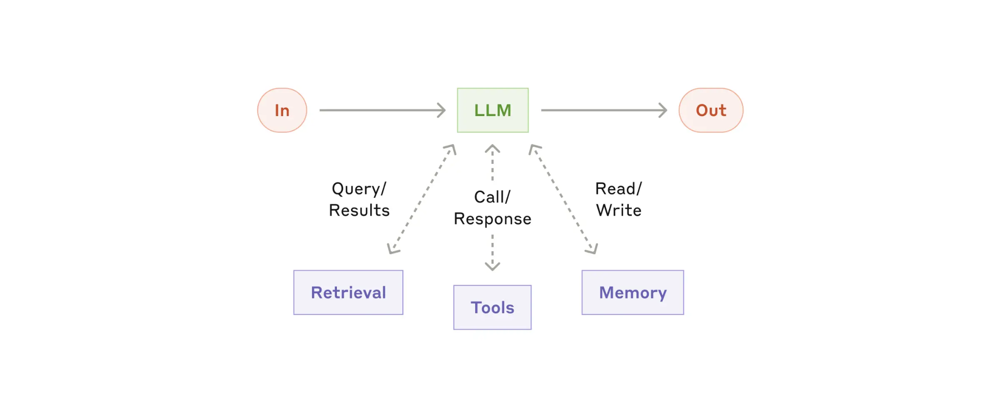
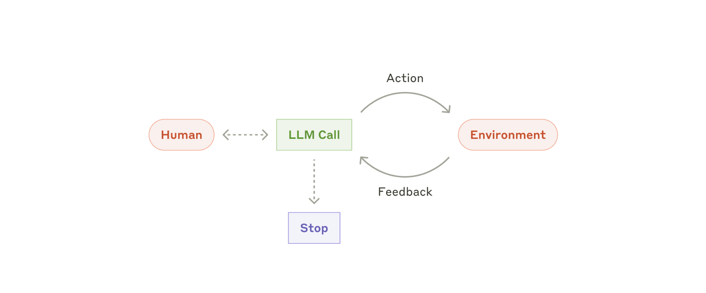
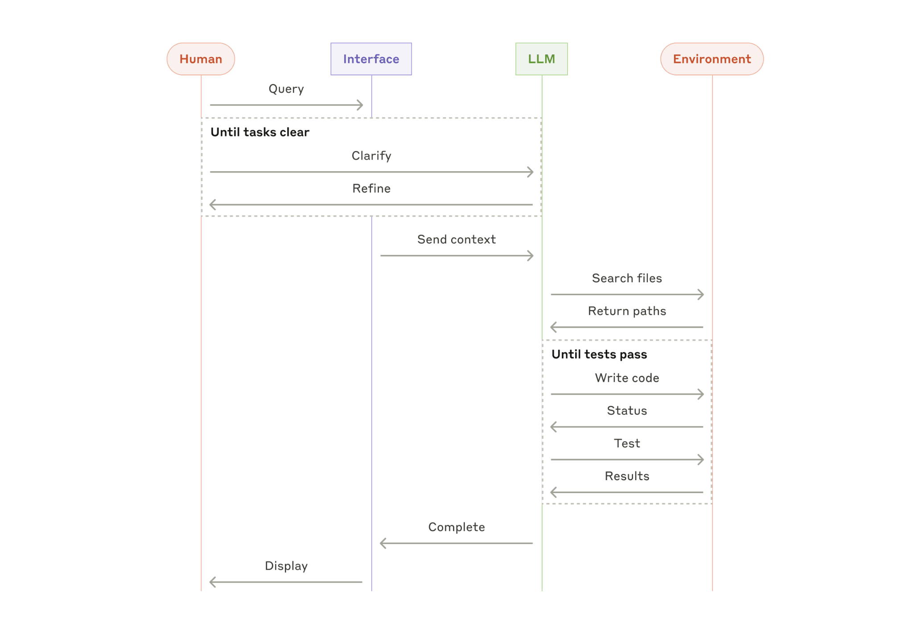

# Qu'est-ce qu'un Agent IA ?

## Workflows vs Agents : la distinction d'Anthropic

> « Le terme **"agent"** peut être défini de plusieurs manières. Certains définissent les agents comme des systèmes entièrement autonomes qui fonctionnent indépendamment pendant de longues périodes, en utilisant différents outils pour accomplir des tâches complexes. D’autres utilisent ce terme pour désigner des implémentations plus prescriptives qui suivent des workflows prédéfinis. Chez Anthropic, nous regroupons toutes ces variantes sous le terme **systèmes agentiques** (*agentic systems*), mais nous établissons une distinction architecturale importante entre les **workflows** et les **agents** :
>
> * **Les workflows** sont des systèmes dans lesquels les LLM et les outils sont orchestrés au travers de chemins d’exécution prédéfinis dans le code.
> * **Les agents**, en revanche, sont des systèmes dans lesquels les LLM dirigent dynamiquement leurs propres processus et l’utilisation des outils, tout en conservant le contrôle sur la manière dont ils accomplissent les tâches. »
>
> — *Source : [Building Effective Agents — Anthropic Engineering](https://www.anthropic.com/engineering/building-effective-agents)*

---

## L'architecture de base : l'« Augmented LLM »

Voici l’architecture de ce qu'Anthropic appelle l'**Augmented LLM** (*LLM augmenté*), qui sert de brique fondamentale à tout système agentique :



On a une information en entrée (**In**) qui passe par un LLM « boosté » avec :
* un système de **Retrieval** (pour chercher de l'information externe) ;
* des **Tools** (des outils qu’il peut appeler) ;
* de la **Memory** (la mémoire sur laquelle il peut lire et écrire) ;

afin de produire le résultat en sortie (**Out**).


**Convention pour la suite :** L'*Augmented LLM* sera notre référence implicite dès que l'on parlera de « LLM » dans un contexte agentique. Sans ces capacités d'augmentation, pas d'agent possible.


---

## Cycle de vie et interaction avec l'environnement

Les agents démarrent soit à partir d’une **commande directe donnée par l’utilisateur humain**, soit au cours d’une **interaction préalable avec celui-ci**. Une fois la tâche clairement définie, les agents planifient et opèrent de manière autonome, avec la possibilité de revenir vers l’utilisateur pour obtenir des informations supplémentaires ou solliciter son jugement.

Au cours de leur exécution, il est crucial que les agents obtiennent à chaque étape une **« vérité terrain » (*ground truth*)** provenant de leur environnement — par exemple, les résultats d’un appel à un outil ou la sortie d'une exécution de code — afin d’évaluer concrètement leur progression.

Les agents peuvent ensuite **mettre leur exécution en pause pour obtenir un retour humain**, soit à des points de contrôle prédéfinis (*checkpoints*), soit lorsqu’ils rencontrent un obstacle bloquant (*blocker*). La tâche se termine généralement une fois qu’elle est accomplie, mais il est également indispensable de définir des **conditions d’arrêt** (*stopping conditions*) — par exemple, un nombre maximal d’itérations ou un budget de tokens — afin de conserver le contrôle sur l’exécution.



Dans le cas d'un agent de codage (comme dans *Agent Smith*), ce cycle prend la forme d'une exploration de fichiers suivie d'une boucle d'écriture de code et de vérification par les tests :



---

## Récapitulatif : les 3 piliers d'un agent

Pour récapituler, on retrouve toujours trois composants essentiels dans la définition d'un agent :
1. **Un modèle** (le moteur de raisonnement) ;
2. **Des outils** (les moyens d'action et de perception) ;
3. **Des instructions** (le prompt système qui cadre son comportement).

### Exemple minimaliste (style SDK)

```python
weather_agent = Agent(
    name="Weather agent",
    instructions="You are a helpful agent who can talk to users about the weather",
    tools=[get_weather],
)
```

### Choisir le bon modèle pour la bonne tâche

Les modèles ont tous leurs points faibles et leurs points forts. Toutes les tâches ne requièrent pas le modèle le plus massif : s’il s’agit simplement de faire de la classification ou du *retrieval*, un modèle plus modeste et léger sera souvent plus pertinent.


**Bonne pratique de prototypage (recommandée aussi par le sujet Agent Smith V.1.1) :**
Construisez d'abord votre prototype d’agent avec le **modèle le plus intelligent disponible** (et sans brider les limites trop tôt) afin d’établir une référence fonctionnelle (*baseline*). Ensuite, basculez vers des modèles plus petits ou plus rapides pour observer l'impact sur les résultats et optimiser le rapport performance / coût / latence.

