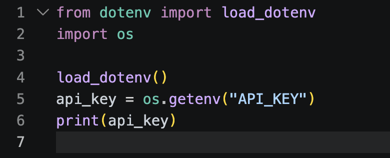

# Fournisseurs d'API LLM & Rotation de Clés

## Pourquoi passer par des fournisseurs d'API distants ?

Contrairement aux projets précédents du cursus 42 (*RAG* ou *Call Me Maybe*) où l'on faisait tourner un petit modèle en local sur notre machine, l’idée derrière **Agent Smith** est d’utiliser les APIs de fournisseurs d'inférence distants (**Groq**, **OpenRouter**, **Together AI**, **Google AI Studio**, **Mistral**, etc.) qui hébergent des modèles de grande taille et exécutent les calculs sur leurs propres clusters de GPU.

**Pourquoi ce choix ?** Parce que faire tourner un LLM localement au sein d'une boucle agentique (qui enchaîne jusqu'à 10 ou 30 itérations avec des contextes allant jusqu'à `300 000` tokens sur SWE-bench) serait extrêmement lent et matériellement impossible avec des modèles capables de résoudre de vrais bugs logiciels (souvent des modèles de 30B à plus de 200B de paramètres).

L’appel API ne fait rien tourner sur votre CPU/GPU local : il permet de bénéficier de la puissance de très grands modèles en quelques secondes via une simple requête HTTP, exactement comme lorsque vous discutez avec Claude ou ChatGPT dans votre navigateur — sauf qu'ici, c'est votre programme Python qui discute directement avec le serveur.


**Aparté technique : « Mais dans RAG et Call Me Maybe aussi il fallait Internet ! »**

On pourrait rétorquer que `Qwen3-0.6B` n’était pas en local lors de *RAG* ou *CMM* parce que chaque lancement affichait un message du type `Sending unauthenticated requests to the HF Hub` et qu'en coupant le Wi-Fi, le programme plantait.

Cela ne signifie pas pour autant que l’inférence était distante : l'appel `model = AutoModelForCausalLM.from_pretrained(...)` contactait les serveurs de Hugging Face uniquement pour vérifier ou télécharger les poids du modèle en cache, mais **le calcul matriciel de génération (`model.generate()`) s'exécutait bel et bien à 100 % en local sur la RAM et le processeur de votre machine**, contrairement à un appel API HTTP.


---

## Qu'est-ce qu'une clé API et comment la protéger ?

Une **clé API (*API Key*)** est un jeton secret d'authentification qui permet à un fournisseur distant d'identifier votre application, de l'autoriser à utiliser son service et de décompter vos quotas d'utilisation (nombre de requêtes par minute, nombre de tokens consommés).


**RÈGLE ABSOLUE : Ne mettez JAMAIS une clé API en dur dans votre code ou dans Git !**

Le sujet (Section VI.3) est formel : **toute clé API trouvée en clair dans votre code source entraînera un échec immédiat de sécurité (note de 0) à l'évaluation.** De plus, les robots scrutent les dépôts Git en permanence et compromettent une clé exposée en quelques secondes.


### La bonne méthode : `.env` + `.gitignore` + `python-dotenv`

1. Créez un fichier `.env` à la racine pour y stocker vos clés secrètes.
2. Ajoutez immédiatement `.env` dans votre fichier `.gitignore`.
3. Installez `python-dotenv` dans les dépendances de votre projet avec `uv` :

```bash
uv add python-dotenv
```

Vous pouvez alors charger proprement vos clés dans votre code Python :



```python
from dotenv import load_dotenv
import os

# Cherche et charge automatiquement le fichier .env (ou le fichier passé en CLI à l'évaluation)
load_dotenv()

api_key = os.getenv("OPENROUTER_API_KEY")
```

On peut également exporter une variable d'environnement directement depuis le terminal :

```bash
export OPENROUTER_API_KEY="sk-or-v1-..."
```


**Rappel pour les scripts d'évaluation (`exam_*.sh`) :**
Lors de la correction, la moulinette passe le chemin d'un fichier `.env` en argument CLI (`--env-file /path/to/.env`). Assurez-vous que votre programme sait à la fois lire les variables d'environnement standard (`OPENROUTER_API_KEY`, `GROQ_API_KEY`, etc.) et charger le fichier `.env` fourni.


---

## Multi-Provider et Rotation de Clés API

Le cahier des charges d'*Agent Smith* (Section V.6.1) impose deux contraintes majeures :
1. **Utiliser exclusivement des tiers gratuits (*free tiers*)** : aucun compte payant ou avec facturation activée n'est autorisé.
2. **Gérer plusieurs fournisseurs et plusieurs clés API par fournisseur (*multi-token rotation*)**.

Pourquoi ? Parce que les offres gratuites appliquent des limites de débit (*rate limits* : requêtes par minute, tokens par minute ou par jour) très strictes, surtout pendant une évaluation où l'agent enchaîne les appels.

Il faut donc concevoir un gestionnaire capable d'associer **une liste de clés API** à un même fournisseur / modèle :

```text
          ┌── API_KEY_1 ──┐
──────────┼── API_KEY_2 ──┼──► Modèle (ex: Qwen / Claude / Llama via OpenRouter ou Groq)
          └── API_KEY_3 ──┘
```

Dès que `API_KEY_1` renvoie une erreur HTTP `429 Too Many Requests` (quota ou rate limit atteint), votre client bascule automatiquement et de manière transparente sur `API_KEY_2`, puis `API_KEY_3`, ou bascule en *fallback* sur un second fournisseur configuré : *technologia* 👨🏽‍💻 !

---

## Clarification : L'Orchestrateur est du code, pas un LLM !

En lisant certains articles sur les systèmes multi-agents, on pourrait croire que « l’Agent Orchestrateur » qui choisit le fournisseur ou gère la boucle est lui-même un LLM qui décide s'il vaut mieux appeler Qwen ou GPT pour telle question.

**Pas du tout !** Dans *Agent Smith*, l’orchestration est **purement algorithmique et codée en Python** :
* C'est votre code Python qui gère la boucle `while iteration < max_iterations`.
* C'est votre code Python qui intercepte une erreur réseau ou un dépassement de quota (`HTTP 429` / `503`), effectue un *exponential backoff*, incrémente le compteur `retries` dans `StepMetrics` et change de clé API dans le pool.
* Et lors de la rédaction du `BENCHMARK_REPORT.md` (qui exige de comparer au moins 5 modèles sur 3 tâches SWE-bench), c'est cette abstraction propre et la rotation de clés qui vous permettront de lancer vos campagnes de tests sans que tout s'arrête au bout de 5 minutes.
