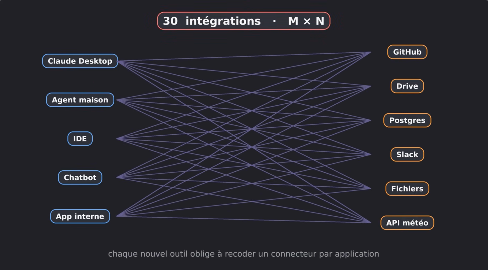
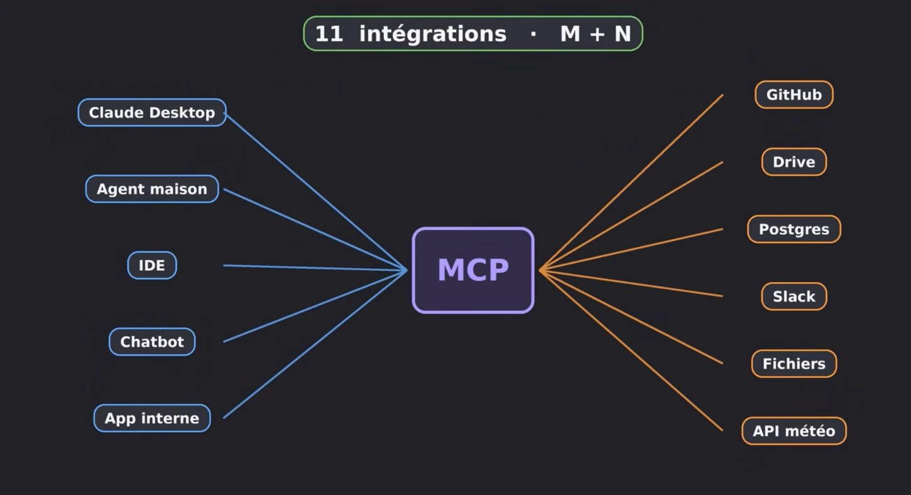
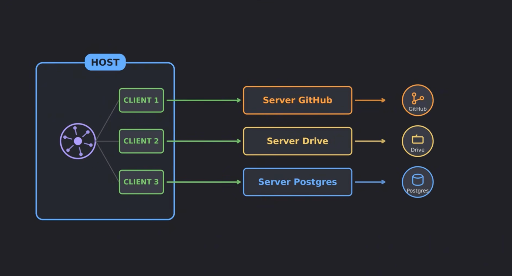
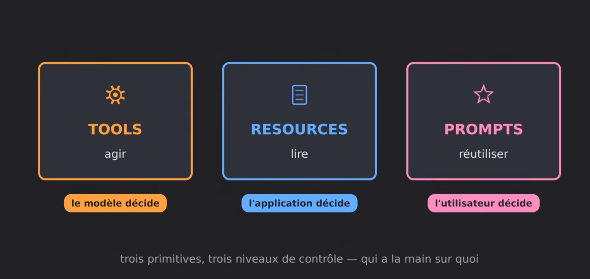
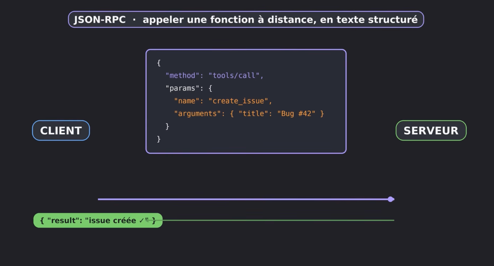
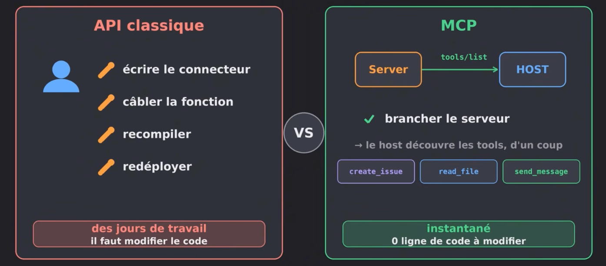
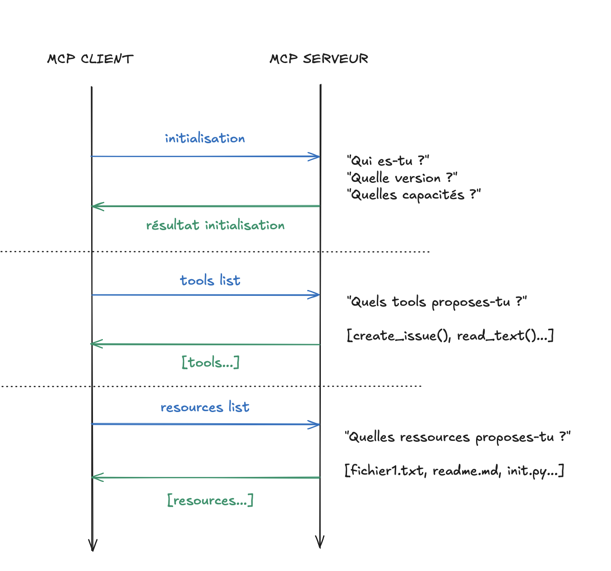
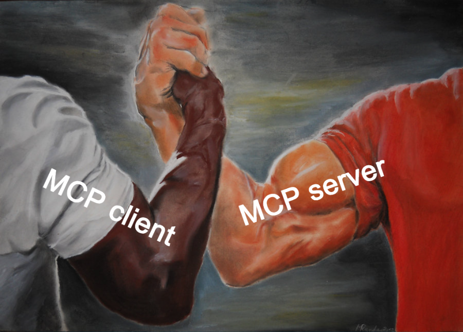
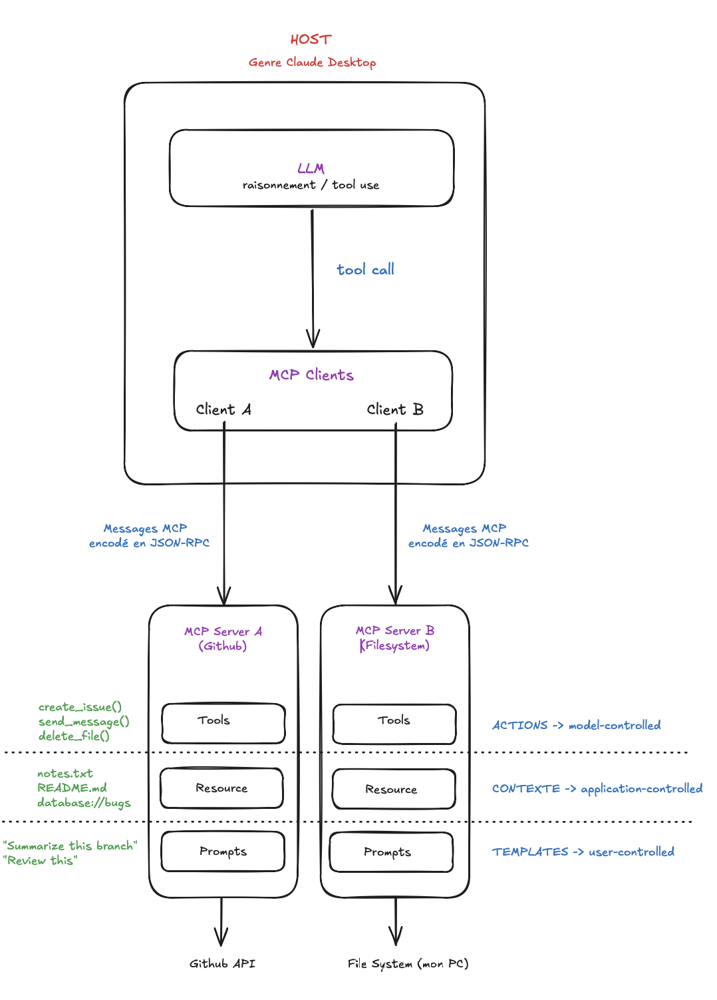

# MCP : Le Model Context Protocol

> *Comment est-il possible que Claude Desktop puisse accéder à des bases de données, des dépôts GitHub, envoyer un message sur Slack et manipuler des outils en tout genre ? Un LLM seul ne sait pas interagir avec le monde extérieur : fondamentalement, il sait uniquement générer du texte. Alors comment peut-il effectuer des actions concrètes ? Pourquoi les API classiques ne suffisaient-elles pas et pourquoi a-t-il fallu inventer un protocole comme MCP ?*

Avant le MCP, les entreprises connectaient leurs IA à leurs outils « à la main ». Chaque application d'IA devait développer ses propres intégrations sur mesure avec chaque service externe. Lorsqu'un nouvel outil ou une nouvelle application apparaissait, il fallait développer et maintenir de nouveaux connecteurs spécifiques : c’était vite ingérable.

Les API permettaient déjà de faire tout cela techniquement. Le problème n'était donc pas une incapacité technique à connecter un LLM à un outil, mais **l'absence d'un standard commun** permettant de décrire, découvrir et utiliser ces outils de manière uniforme. Il y avait autant d’intégrations que de paires `(application × outil)` : c’est le **problème $M \times N$**.

En novembre 2024, Anthropic publie le **Model Context Protocol (MCP)** (dont la gouvernance a depuis été transférée fin 2025 à l'*Agentic AI Foundation* sous l'égide de la Linux Foundation) : l'objectif est de standardiser la manière dont une application d'IA découvre et utilise des outils et des sources de contexte externes.

---

## Quelques définitions essentielles

* **Protocole** : ensemble de règles et de formats permettant à deux systèmes distincts de communiquer.
* **Serveur** : programme qui fournit des données ou des capacités d'action à la demande.
* **Client** : composant qui sollicite ces données ou capacités auprès du serveur.
* **Function calling / Tool use** : capacité d'un modèle à produire une demande structurée indiquant qu'il souhaite appeler une fonction externe. **Le LLM n'exécute jamais directement l'action : il demande à son environnement qu'une action soit effectuée.**

---

## 1. Le problème $M \times N$

Imaginons que l'on ait **$M$ applications IA** :
* ChatGPT Desktop ;
* Claude Desktop ;
* un assistant intégré à un IDE (VS Code, Cursor...) ;
* un chatbot d'entreprise ou notre agent maison (*Agent Smith*) ;
* etc.

Et **$N$ outils ou sources de données** :
* GitHub ;
* Google Drive ;
* Slack ;
* une base de données PostgreSQL ;
* le système de fichiers local ;
* une API interne ;
* etc.

### Sans MCP : $M \times N$ intégrations spécifiques

Pour que chaque application puisse utiliser chaque outil, il fallait coder et maintenir un connecteur spécifique par couple `(application, outil)` :

$$M \text{ applications} \times N \text{ outils} = M \times N \text{ intégrations potentielles}$$



### Avec MCP : $M + N$ implémentations

L'idée du MCP est de définir un **langage commun** entre les applications d'IA et les outils. Au lieu que chaque application parle un dialecte différent à chaque outil, on place une interface standardisée au milieu :



Chaque serveur expose ses capacités selon le protocole MCP, et chaque application compatible MCP sait lire cette interface. On passe donc de **$M \times N$ intégrations** à **$M$ clients MCP + $N$ serveurs MCP**.

Anthropic utilise la **métaphore du port USB-C** : avant, chaque appareil exigeait son propre chargeur et son propre câble propriétaire ; l'USB-C fournit une prise standardisée permettant à n'importe quel périphérique de dialoguer avec n'importe quel ordinateur.

---

## 2. Architecture : Host, Client et Serveur

L'architecture MCP repose sur **trois rôles** (au sens technique du protocole) :
1. **Host (Hôte)**
2. **Client MCP**
3. **Serveur MCP**



### Le Host (Hôte)
C’est le programme principal, l'application d'IA dans laquelle on travaille (ex: Claude Desktop, VS Code, ou le système *Agent Smith*). C’est lui qui coordonne la logique globale, orchestre les appels au modèle et instancie les clients MCP.

### Le Client MCP
C’est un composant interne hébergé à l'intérieur du Host (dans *Agent Smith*, le client MCP vit à l'intérieur de la **Sandbox**). On crée généralement **un client par serveur MCP** auquel on souhaite se connecter.
* *Analogie :* on peut voir les clients MCP comme des câbles dédiés reliant l'hôte à chaque serveur externe (un câble vers GitHub, un câble vers Drive, un câble vers Postgres).

### Le Serveur MCP
C'est un programme indépendant qui expose des capacités (outils, ressources, prompts) via le protocole MCP. Il agit comme un adaptateur entre le standard MCP et le système réel situé derrière :

$$\text{Host / Sandbox} \longrightarrow \text{Client MCP} \longrightarrow \text{Serveur MCP} \longrightarrow \text{Système de fichiers / Docker / API}$$

---

## Les 3 primitives exposées par un serveur MCP

Qu'est-ce qu'un serveur MCP met concrètement à disposition ? On appelle cela les **primitives MCP**, et il en existe trois principales, chacune ayant un niveau de contrôle différent :





### Les Tools (`model-controlled`)
Les **tools** sont des fonctions exécutables que le modèle peut appeler (ex: `read_file`, `edit_file`, `run_tests`, `create_issue`).
* **Effets de bord :** un tool peut modifier l'état du monde extérieur (écrire sur le disque, lancer un script, modifier un dépôt Git).
* **Contrôle :** ils sont dits **`model-controlled`** car c'est le LLM qui décide quand et avec quels arguments les appeler au cours de son raisonnement (même si le Host ou la Sandbox peut imposer des gardes-fous).



### Les Ressources (`application-controlled`)
Les **ressources** sont des sources de données passives (fichiers, schémas de base de données, documentation, logs) mises à disposition pour enrichir le contexte.
* **Différence fondamentale avec un tool :** *un tool effectue une action ; une ressource fournit du contexte sans effet de bord.*
* **Contrôle :** elles sont dites **`application-controlled`** car c'est généralement l'application cliente (le Host) qui décide comment et quand charger ces ressources dans le contexte du modèle.



### Les Prompts (`user-controlled`)
Les **prompts** sont des modèles d'instructions réutilisables (*templates*) exposés par le serveur (ex: un serveur Git qui expose le prompt pré-configuré *« Résume les changements de cette branche »*).
* **Contrôle :** ils sont dits **`user-controlled`** car ils sont conçus pour être sélectionnés ou déclenchés à l'initiative de l'utilisateur (par exemple via une commande `/` dans une interface).



---

## Format des messages, Handshake et Transports

### 1. Dans quelle langue ces messages voyagent-ils ? (JSON-RPC 2.0)

Le dialogue MCP (initialisation, découverte des capacités, appel de tools, lecture de ressources) utilise le format **JSON-RPC 2.0** (*JSON Remote Procedure Call*).

L'idée derrière un RPC est de demander à un autre processus d'exécuter une fonction à distance comme s'il s'agissait d'un appel local (cela rappelle fortement le format des sorties que nous manipulions dans *Call Me Maybe*).



### 2. Le « Handshake » et la découverte dynamique

Quand un client MCP se connecte à un serveur MCP, il ne connaît pas nécessairement à l'avance les outils que ce serveur propose (d'ailleurs, le sujet *Agent Smith* précise que votre sandbox sera testée avec un **serveur MCP inconnu** lors de la soutenance !).

La connexion démarre donc toujours par une phase d'**initialisation** appelée **handshake** :
1. Quelles versions du protocole sont supportées ?
2. Quelles capacités (*capabilities* : `tools`, `resources`, `prompts`) sont activées ?
3. Échange des métadonnées d'identification Client ↔ Serveur.

Une fois le handshake validé, le client interroge dynamiquement le serveur (`tools/list`, `resources/list`, `prompts/list`) : *« Quels tools proposes-tu ? »*. Le serveur répond avec la liste de ses outils, leurs descriptions et le schéma JSON de leurs paramètres.







### 3. Par où les messages transitent-ils ? (`stdio` vs `HTTP`)

Il est essentiel de ne pas confondre le protocole et le transport :
* **MCP** définit la sémantique (capacités, cycle de vie, outils/ressources/prompts) ;
* **JSON-RPC** définit la syntaxe des messages échangés ;
* **Le transport (`stdio` ou `HTTP`)** définit le tuyau par lequel ces messages circulent.

Le sujet *Agent Smith* exige de supporter les deux transports standards :

1. **`stdio` (*Standard Input / Output*)** : le classique du langage C. Le client lance le serveur MCP comme un sous-processus local et communique avec lui en écrivant des requêtes JSON-RPC sur son `stdin` et en lisant les réponses sur son `stdout`.
   $$\text{Host / Sandbox} \longrightarrow \text{Client MCP} \xrightarrow{\text{stdin / stdout}} \text{Serveur MCP local}$$
2. **`HTTP` (*Streamable HTTP*)** : utilisé lorsque le serveur MCP tourne déjà de manière indépendante (en local ou sur une machine distante) et écoute sur une URL réseau.
   $$\text{Host / Sandbox} \longrightarrow \text{Client MCP} \xrightarrow{\text{Réseau HTTP}} \text{Serveur MCP distant}$$

---

## 3. Déroulement complet d'une boucle agentique avec MCP

Visualisons une boucle complète. On demande à un agent : *« Crée une issue GitHub qui résume les bugs décrits dans le fichier `notes.txt`. »*

### Étape 1 — Découverte dynamique
Au démarrage, le client MCP effectue le handshake avec ses serveurs et découvre deux outils accompagnés de leurs schémas : `read_file` et `create_issue`. À partir de ces schémas, la Sandbox génère dynamiquement un **manuel d'utilisation** qui est injecté dans le prompt système du LLM.

### Étape 2 — Décision et génération de l'appel
Le modèle raisonne sur la tâche et conclut qu'il doit d'abord lire `notes.txt`.


**Différence fondamentale dans Agent Smith : CodeAct vs JSON Tool Calling !**

Dans un agent JSON classique (comme Claude Desktop), le modèle produit un objet JSON de demande d'outil :
```json
{
  "tool": "read_file",
  "args": { "path": "notes.txt" }
}
```
Mais dans **Agent Smith** (Chapitre III.1 du sujet), vous implémentez une approche **Code Agent (CodeAct)** : le LLM ne communique pas avec la sandbox en JSON, il génère directement du **code Python exécutable** :
```python
content = read_file(filepath="notes.txt", start_line=1, end_line=50)
print(content)
```
C'est l'exécution de ce code Python **à l'intérieur de la Sandbox** qui appelle la fonction wrapper Python `read_file(...)`, laquelle utilise le **Client MCP** de la sandbox pour envoyer la requête **JSON-RPC** au **Serveur MCP** !

*(Astuce : renseignez-vous sur le SDK officiel `mcp` et le framework [FastMCP](https://gofastmcp.com/getting-started/welcome) pour comprendre comment exposer proprement des fonctions Python en serveur MCP, tout en vérifiant la conformité stricte avec les tests de `exam_sandbox.sh`.)*


### Étape 3 — Exécution via le Serveur MCP
1. Le wrapper Python dans la sandbox transmet l'appel au Client MCP.
2. Le Client MCP envoie la requête JSON-RPC (`tools/call`) au Serveur MCP.
3. Le Serveur MCP exécute réellement l'opération sur le système (il lit `notes.txt`) et renvoie le résultat au Client MCP, puis à la Sandbox.

Le LLM, lui, n'a jamais touché au disque dur : c'est le système autour du modèle qui exécute l'action.

### Étape 4 — Observation et itération suivante
La sortie (`stdout`) de la sandbox contenant le texte de `notes.txt` est renvoyée au LLM sous forme d'**Observation**. Le modèle analyse les bugs décrits et génère au tour suivant l'appel à `create_issue(...)`, et ainsi de suite :

$$\text{Observation} \longrightarrow \text{Thought (Raisonnement)} \longrightarrow \text{Code (Action)} \longrightarrow \text{Observation} \longrightarrow \dots$$

> **À retenir :** **MCP n'est pas le cerveau de l'agent.** Le raisonnement reste dans le LLM, et l'orchestration de la boucle reste dans votre code Python. MCP fournit uniquement le mécanisme standardisé permettant de découvrir les outils, de demander leur exécution et d'en récupérer les résultats.

---

## Schéma récapitulatif global de l'architecture MCP


