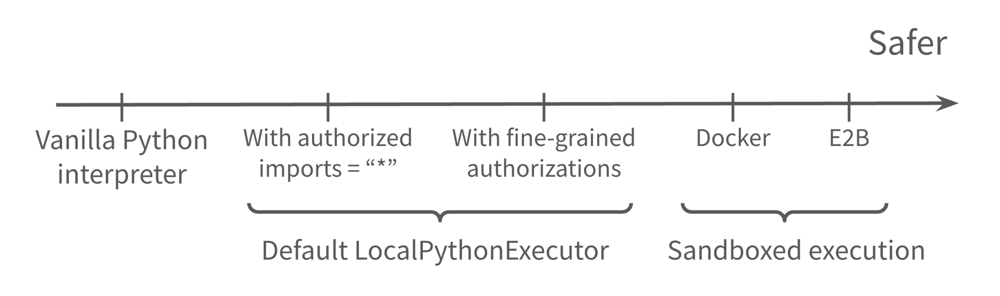
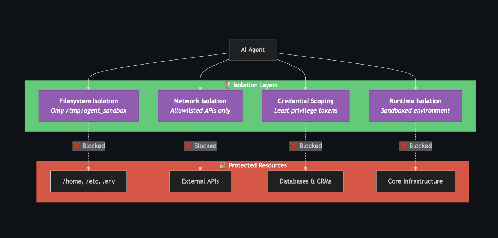

# La Sandbox : Exécution Isolée en Python

## Pourquoi une Sandbox est-elle indispensable ?

Dans *Agent Smith*, votre système exécute du code Python généré dynamiquement par un LLM. Exécuter directement ce code sans protection dans votre environnement hôte comporte des risques critiques :

* **Simple erreur ou hallucination du LLM** : les modèles sont loin d'être infaillibles et peuvent générer involontairement des commandes destructrices ou des boucles infinies qui saturent la RAM alors même qu'ils cherchent à résoudre le bug.
* **Attaque de la chaîne d'approvisionnement (*Supply Chain Attack*)** : un modèle ou un endpoint tiers compromis pourrait renvoyer une charge utile malveillante.
* **Injection de prompt (*Prompt Injection*)** : un texte malveillant présent dans une issue ou un fichier analysé pourrait détourner le modèle pour lui faire exécuter du code arbitraire.
* **Exploitation d'agents exposés** : dès qu'un agent dispose d'une capacité d'exécution de code, il se situe tout en haut du **spectre de l'autonomie (*spectrum of agency*)**. Plus l'autonomie accordée au modèle est grande, plus l'impact potentiel d'une défaillance sur le système de fichiers, les secrets (`.env`) ou le réseau est élevé.

Pour réduire ce risque, il existe un continuum de solutions d'isolation offrant des garanties de sécurité croissantes au prix d'une complexité de mise en place plus importante :

---

## Les couches d'isolation exigées par Agent Smith

Dans ce projet, la **Sandbox** désigne l'environnement d'exécution isolé qui restreint strictement ce que le code Python généré par le LLM a le droit de faire :

Conformément à la Section V.2 du sujet, votre sandbox doit appliquer six barrières de sécurité :
1. **Restrictions sur les imports Python** : seuls les modules listés dans `authorized_imports` de `SandboxConfig` (`math`, `collections`, `itertools`, `re`, `json`, etc.) peuvent être importés. Tout le reste (`os`, `sys`, `subprocess`, `socket`, `shutil`, `pathlib`, etc.) est bloqué par défaut.
2. **Isolation du système de fichiers** : tout accès fichier par le code sandboxé est restreint à la liste blanche `allowed_directories` (par défaut `["/testbed", "/tmp/agent"]`). Tout accès en dehors (ex: `/etc/passwd`, `/home`, `.env`, ou traversée via `../` et liens symboliques) doit être refusé.
3. **Aucun accès réseau** : bloquer toute connexion réseau sortante ou entrante depuis le code exécuté dans la sandbox.
4. **Timeout d'exécution** : interrompre proprement tout bloc de code dépassant `max_execution_time_seconds` (par défaut `30` secondes).
5. **Limite de mémoire vive (RAM)** : interrompre tout code dépassant `max_memory_mb` (par défaut `512` Mo).
6. **Built-ins restreints** : supprimer ou surcharger les fonctions natives dangereuses (`eval`, `exec`, `compile`, `__import__`, `open`, `getattr` sur attributs privés `__subclasses__`, etc.) pour empêcher toute escalade de privilèges.


**Contrainte stricte du sujet : Pur Python standard uniquement !**
Vous devez implémenter ces mécanismes de sécurité **vous-mêmes en utilisant uniquement la bibliothèque standard de Python et ses built-ins**. L'utilisation de paquets externes dédiés comme `RestrictedPython` (ou de SDK clés en main comme LangSmith Sandboxes / E2B qui reposent dessus) est **formellement interdite** et fera échouer l'évaluation (`exam_sandbox.sh`).


---

## Les 3 stratégies théoriques d'implémentation face au sujet

Il existe globalement trois grandes stratégies pour isoler l'exécution de code Python. Voyons comment chacune s'articule avec *Agent Smith* :

### 1. Les restrictions au niveau du langage et du processus Python (Le cœur du travail)
* **Théorie :** restreindre les capacités de l'interpréteur Python lui-même avant et pendant l'exécution d'un bloc de code.
* **Dans Agent Smith :** c'est le cœur de ce qui est testé par `exam_sandbox.sh`. Voici les quatre briques de la bibliothèque standard à combiner :
  1. **Analyse syntaxique en amont (`ast`)** : parser le code généré par le LLM avec `ast.parse()` **avant même de l'exécuter**. En parcourant l'arbre syntaxique (`ast.NodeVisitor`), vous pouvez bloquer immédiatement les nœuds `ast.Import` / `ast.ImportFrom` non autorisés, l'accès aux attributs dunder (`__class__`, `__bases__`, `__subclasses__`, `__globals__`, `__builtins__`), ou les appels interdits.
  2. **Dictionnaire de Namespace restreint (`globals` / `locals`)** : lors de l'appel à `exec(code, sandbox_globals)`, passer un dictionnaire contrôlé contenant uniquement les wrappers des outils MCP connectés, la fonction `final_answer`, et les variables persistées entre les étapes.
  3. **Redéfinition de `__builtins__`** : remplacer la clé `__builtins__` dans `sandbox_globals` par un dictionnaire nettoyé :
     * remplacer `__import__` par une fonction personnalisée qui vérifie `SandboxConfig.authorized_imports` ;
     * remplacer `open` par une fonction sécurisée qui résout le chemin réel (`os.path.realpath`) et vérifie qu'il appartient bien à l'un des dossiers de `SandboxConfig.allowed_directories` ;
     * supprimer `eval`, `exec`, `compile`, `input`, `breakpoint`, etc.
  4. **Isolation par sous-processus (`multiprocessing` / `subprocess`) et limites système (`resource`, `signal`)** : exécuter le code dans un processus fils dédié permet d'appliquer des limites mémoire au niveau OS (`resource.setrlimit(resource.RLIMIT_AS, ...)`) et de tuer proprement un code bloqué dans une boucle infinie (`process.terminate()` / `SIGKILL`) après `max_execution_time_seconds`.

### 2. L'isolation au niveau du conteneur / OS (Docker)
* **Théorie :** utiliser des conteneurs Linux (namespaces PID, mount, network + cgroups) ou des micro-VM (Firecracker, gVisor) pour isoler l'environnement.
* **Dans Agent Smith :** pour le benchmark **SWE-bench**, chaque tâche fournit une image Docker dédiée. Le sujet (Section V.4) précise que **les deux architectures suivantes sont valides** :
  * **Option A :** déployer la sandbox à l'intérieur du conteneur Docker de la tâche ;
  * **Option B :** faire tourner la sandbox sur la machine hôte, tandis que les outils du serveur MCP (`mcp_tools_swebench.py`) exécutent leurs actions à l'intérieur du conteneur Docker (par exemple via `docker exec`).
  * *Attention : quel que soit votre choix (A ou B), toutes les contraintes de sécurité Python de la sandbox (imports, paths, builtins, timeout, RAM, réseau) doivent rester actives !*

### 3. L'exécution WebAssembly (WASM / Pyodide)
* **Théorie :** compiler l'interpréteur Python en WebAssembly (ex: Pyodide) pour éliminer tout accès direct aux appels système (*syscalls*) de l'OS hôte.
* **Dans Agent Smith :** bien qu'intéressante sur le plan théorique (voir la bibliographie), cette approche introduit une lourdeur et une complexité hors de propos par rapport aux exigences de la bibliothèque standard du sujet.

---

## Deux subtilités architecturales à ne pas rater


### 1. `final_answer()` n'est PAS un outil MCP !
Le sujet (Section V.2.2) insiste fortement sur cette frontière architecturale :
* Les **outils MCP** (`read_file`, `run_tests`, etc.) sont découverts dynamiquement auprès du serveur MCP connecté. Si l'évaluateur branche un autre serveur MCP, ces outils changent.
* La fonction **`final_answer(solution)`** est **toujours injectée directement par la Sandbox elle-même** dans son namespace d'exécution, quel que soit le serveur MCP connecté. Lorsqu'elle est appelée par le code du LLM, elle capture la réponse finale et signale à l'orchestrateur que la boucle agentique est terminée.



### 2. Ne confondez pas le Timeout de la Sandbox et le Timeout du Benchmark !
* **Timeout de la Sandbox (`max_execution_time_seconds = 30s`)** : s'applique **uniquement** à l'exécution d'un bloc de code Python dans la sandbox (et ne s'applique **pas** au temps pris par les outils du serveur MCP comme `run_tests()`).
* **Timeout global de l'évaluation (`120s` pour MBPP, `900s` pour SWE-bench)** : s'applique à la durée totale de résolution de la tâche (toutes les itérations LLM + Sandbox + MCP cumulées).
* Enfin, pensez à **ne jamais étouffer silencieusement `KeyboardInterrupt` et `SystemExit`** dans votre sandbox : ces exceptions doivent remonter jusqu'à l'orchestrateur pour permettre un arrêt propre.

